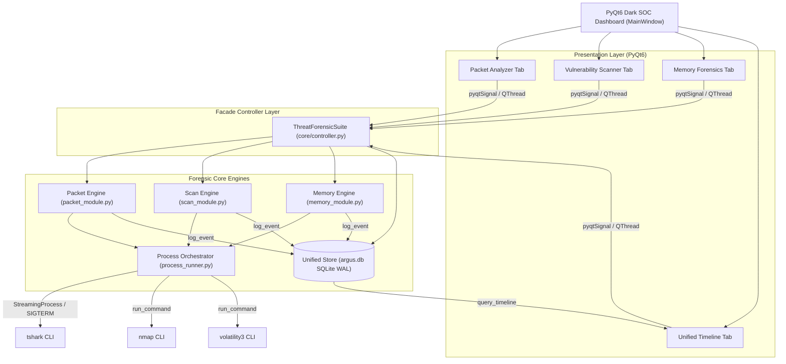

# ARGUS — Cyber Threat & Forensic Analysis Suite

[](https://www.kali.org/)
[](https://www.python.org/)
[](https://riverbankcomputing.com/software/pyqt/)
[](LICENSE)
[](ACCEPTABLE_USE.md)

**Author:** Muhammad Inshal  
**Version:** v1.0.0  
**Target Platform:** Kali Linux  
**Architecture:** Facade / Orchestration Pattern over Battle-Tested Forensics Engines  

---

## 👁️ Overview

Named after **Argus Panoptes**, the hundred-eyed all-seeing guardian of Greek mythology, **Project ARGUS** is a desktop Security Operations Center (SOC) incident investigation platform. Built in Python and PyQt6, ARGUS orchestrates network traffic analysis, vulnerability port scanning, and volatile RAM forensics, synchronizing findings from disparate sources into a unified, UTC-aligned chronological timeline.

ARGUS follows a core engineering principle: **Orchestrator, Not Reimplementer**. Rather than relying on custom, fragile protocol parsers, ARGUS leverages battle-tested, peer-reviewed industry tools:

| Module | Underlying Engine | Key Capabilities |
| :--- | :--- | :--- |
| **Module A: Packet Analyzer** | `tshark` (Wireshark) | Live promiscuous sniffing, protocol breakdown, top talkers, cleartext credential detection, SYN sweep heuristics |
| **Module B: Vulnerability Scanner** | `nmap` | Non-blocking service and version detection (`-sV -T4 -Pn`), strict target allowlist with resolved-IP validation |
| **Module C: Memory Forensics** | `volatility3` | Non-destructive dump hashing (SHA-256), OS auto-detection, process pool correlation (`psscan` vs `pslist`), `malfind` code injections |
| **Phase 6: Unified Timeline** | SQLite (WAL mode) | Multi-engine event indexing, 5-level severity model (`info`, `low`, `medium`, `high`, `critical`), CSV/JSON export with formula injection protection |

---

## 🏛️ System Architecture



---

## 🌟 Feature Breakdown by Module

### 📡 Module A: Packet Analyzer
- **Live Promiscuous Capture:** Captures on active network interfaces (`lo`, `eth0`, `wlan0`) with user-defined BPF filters.
- **Process Group Termination:** Spawns `tshark` in its own process group (`start_new_session=True`), ensuring clean `SIGTERM -> SIGKILL` teardown without orphaned `dumpcap` child processes.
- **Offline PCAP Ingestion:** Rapid JSON parsing of existing `.pcap` / `.pcapng` files.
- **Traffic Analytics:** Computes total packet volume, byte counts, and top 10 bandwidth talkers with percentage shares.
- **Heuristic Indicators:**
  - `unencrypted_http`: Surfaces cleartext HTTP authentication and administrative endpoints (`medium` severity).
  - `port_scan_detected`: Detects TCP SYN port sweeps from external IPs without ACK responses (`medium` severity).

### 🎯 Module B: Vulnerability Scanner
- **Target Allowlist Guardrail:** Blocks unauthorized scanning by enforcing RFC 1918 private subnets (`127.0.0.0/8`, `10.0.0.0/8`, `172.16.0.0/12`, `192.168.0.0/16`) and local hostnames.
- **Resolved IP Verification:** Resolves target hostnames and validates all resolved IP addresses against allowlist ranges before passing targets to Nmap, preventing DNS rebinding.
- **Argument Injection Protection:** Rejects targets starting with `-` and prefixes all targets with `--` to prevent parameter injection.
- **Diagnostic Host Feedback:** Recognizes when scanned hosts are up even when all scanned ports are closed or filtered, providing actionable feedback rather than reporting scan failures.
- **Risky Service Triage:** Flags sensitive and insecure services (Telnet, FTP, SMB, RDP, Redis, VNC) with categorized severity tags and investigation guidance.

### 🧠 Module C: Memory Forensics
- **Forensic Image Integrity:** Validates regular files (`stat.S_ISREG`), verifies read permissions, and computes a SHA-256 cryptographic digest in 64 KB chunks upon ingestion without modifying source dumps.
- **OS Auto-Detection:** Inspects memory headers (ELF, Windows crash dump headers, kernel banners) to automatically select architecture-specific plugin profiles.
- **Plugin Isolation:** 
  - Windows: `windows.pslist`, `windows.pstree`, `windows.psscan`, `windows.cmdline`, `windows.netscan`, `windows.malfind`.
  - Linux: `linux.pslist`, `linux.pstree`, `linux.psscan`, `linux.sockstat`, `linux.malfind`, `linux.bash`.
  - Rejects cross-OS plugin invocation with clear diagnostic error handling.
- **Hidden Process Detection:** Correlates memory pool scanning (`psscan`) against active doubly-linked lists (`pslist`) to identify unlinked or terminated processes (`medium` severity lead).
- **Injected RWX Region Analysis (`malfind`):** Identifies executable memory pages unbacked by disk modules, with disassembly and hex dump inspection.

### ⏱️ Phase 6: Unified Chronological Timeline
- **Event Correlation:** Normalizes findings from network packets, port scans, and RAM dumps into a single SQLite database running in WAL (Write-Ahead Logging) mode.
- **True Event Timestamps:** Uses the event's native timestamp (packet capture time, scan probe time, or process creation time in UTC ISO-8601) rather than database insertion time.
- **Standardized Severity Vocabulary:** Consistent 5-level scale: `critical`, `high`, `medium`, `low`, and `info`.
- **Export Protection:** Generates forensic reports in JSON and CSV formats, sanitizing cells against formula injection (`=`, `+`, `-`, `@`, `\t`).

---

## 🚀 Setup & Installation (Kali Linux)

### 1. System Packages
Install required underlying tools and virtual environment dependencies:
```bash
sudo apt update
sudo apt install -y wireshark-common tshark nmap python3-venv python3-pip
```

### 2. Configure Non-Root Capture Permissions
Grant packet capture permissions to your standard user account:
```bash
sudo usermod -aG wireshark $USER
```
> [!IMPORTANT]
> Log out and log back in to apply the `wireshark` group permission changes.

### 3. Clone Repository & Setup Virtual Environment
```bash
git clone https://github.com/MuhammadInshal231/argus-forensic-suite.git
cd argus-forensic-suite

# Create virtual environment sharing system site-packages
python3 -m venv --system-site-packages .venv
source .venv/bin/activate

# Install Python requirements
pip install -r requirements.txt
```

---

## 💻 User Guide & Walkthrough

### Launching the GUI Dashboard
```bash
source .venv/bin/activate
python main.py
```

### Running the Headless Demo Pipeline
To verify the full correlation pipeline without launching the GUI:
```bash
source .venv/bin/activate
python main.py --demo
```

### Tab-by-Tab Operations
1. **Packet Analyzer Tab:**
   - Select network interface or click **Load Sample PCAP** to inspect sample capture traffic.
   - Click **Start Capture** for real-time streaming, or specify BPF filters (e.g. `tcp port 80`).
   - Inspect protocol breakdown, top talkers, and anomalies.
2. **Vulnerability Scanner Tab:**
   - Enter private lab target (e.g. `127.0.0.1` or `192.168.1.1`).
   - Select scan profile: Fast Scan (`-F -sV`), Comprehensive (`-sV -sC`), or Custom.
   - Click **Run Vulnerability Scan** and review discovered services and risk descriptions.
3. **Memory Forensics Tab:**
   - Select a memory image (`.raw`, `.vmem`, `.dmp`) or click **Load Lab Sample**.
   - Set OS architecture to **Auto-Detect OS**, **Windows**, or **Linux**.
   - Click **Run Memory Forensics** to inspect processes, active network sockets, and `malfind` code injections.
4. **Unified Timeline Tab:**
   - Click **Refresh** to correlate events across all three modules.
   - Filter by module, severity level (`critical`, `high`, `medium`, `low`, `info`), display cap, or search keywords.
   - Click **Export Report** to produce structured JSON or CSV forensic deliverables.

---

## 🧪 Automated Test Suite

ARGUS maintains a multi-tiered test suite that can run completely offline without external network dependencies:

```bash
# Run all automated integration tests
.venv/bin/python tests/test_e2e_integration.py

# Run standalone offline parser and concurrency tests
.venv/bin/python tests/test_offline_parsers.py

# Run Phase 7B security hardening tests
.venv/bin/python tests/test_phase7b_security.py

# Run Phase 7C correctness and 5-level severity tests
.venv/bin/python tests/test_phase7c_correctness.py

# Run individual component suites
.venv/bin/python tests/test_phase1_process.py
.venv/bin/python tests/test_phase2_packet.py
.venv/bin/python tests/test_phase3_scan.py
.venv/bin/python tests/test_phase4_memory.py
.venv/bin/python tests/test_controller.py
```

---

## ⚠️ Known Limitations

1. **Linux Kernel Symbols:** Volatility 3 requires an Intermediate Symbol File (ISF JSON) matching the exact target Linux kernel version. If missing, ARGUS surfaces a clear diagnostic rather than a traceback.
2. **Heuristic Findings:** Detection rules (e.g. SYN sweep, suspicious process names, unusual listening ports) represent investigative leads requiring human analyst review, not definitive proof of compromise.
3. **Platform Scope:** Engineered and tested specifically for Kali Linux on x86_64 architecture.

---

## 🛡️ Legal and Ethical Notice

Project ARGUS is released under the **Inshal Software License**. It is intended solely for authorized educational laboratories, defensive research, and approved penetration testing engagements. The author accepts no liability for unauthorized usage or network disruption. Operators are responsible for complying with all applicable computer crime legislation, including the **Prevention of Electronic Crimes Act (PECA) 2016**.

---

## 📄 License

Licensed under the Inshal Software License. See the [`LICENSE`](LICENSE) file or [`Inshal_Software_License.pdf`](Inshal_Software_License.pdf).  
Free to use, modify and sell. Please credit the creator.  
No illegal or unauthorized use.  

**Original Author:** Muhammad Inshal  
**Original Repository:** https://github.com/MuhammadInshal231/argus-forensic-suite  

---

## 👏 Credits & Acknowledgments

Project ARGUS stands on the shoulders of these industry-standard open-source projects:
- **[Wireshark / TShark](https://www.wireshark.org/):** Network packet analysis and dissectors.
- **[Nmap](https://nmap.org/):** Network discovery and vulnerability scanning.
- **[Volatility 3](https://github.com/volatilityfoundation/volatility3):** Volatile memory forensics framework.
- **[PyQt6](https://www.riverbankcomputing.com/software/pyqt/):** Python bindings for Qt application framework.
