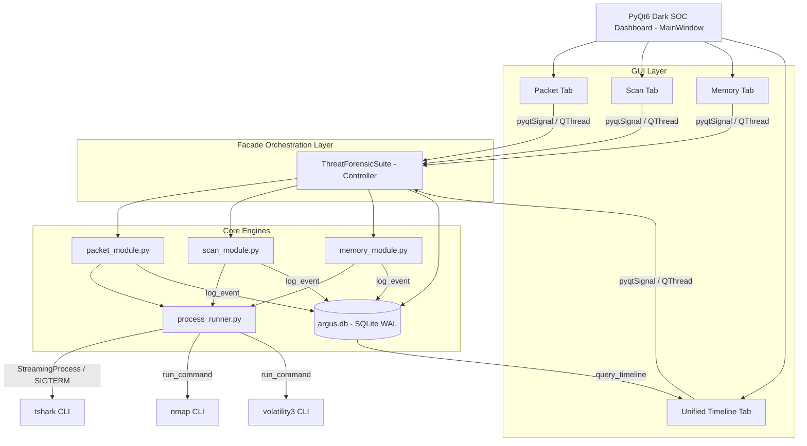

# ARGUS — Cyber Threat & Forensic Analysis Suite

[](https://www.kali.org/)
[](https://www.python.org/)
[](https://riverbankcomputing.com/software/pyqt/)
[](LICENSE)
[](ACCEPTABLE_USE.md)

**Author:** Muhammad Inshal  
**Target Platform:** Kali Linux (Exclusive)  
**Architecture:** Facade / Orchestration Pattern over Battle-Tested Forensics Engines  

---

## 👁️ Overview & Name Rationale

Named after **Argus Panoptes**, the all-seeing giant of Greek mythology covered in a hundred vigilant eyes, **Project ARGUS** is a unified Security Operations Center (SOC) forensic dashboard. It unifies network traffic inspection, vulnerability port scanning, and volatile RAM memory forensics into a single coherent incident timeline.

ARGUS adheres to the foundational engineering principle: **Orchestrator, Not Reimplementer**. Rather than creating fragile, custom protocol parsers, ARGUS wraps and unifies three battle-tested industry standard tools:

| Module | Underlying Engine | Forensic Role |
| :--- | :--- | :--- |
| **Module A: Packet Analyzer** | `tshark` (Wireshark CLI) | Non-root live packet capture, protocol distribution & traffic anomaly detection |
| **Module B: Vulnerability Scanner** | `nmap` | Structured XML service/version discovery with strict lab allowlist guardrails |
| **Module C: Memory Forensics** | `volatility3` | Volatile RAM triage (process enumeration, network sockets, code injection via `malfind`) |
| **Phase 6: Unified Timeline** | SQLite (WAL mode) | Cross-module chronological correlation with JSON/CSV forensic report generation |

---

## 🏛️ System Architecture



---

## 📂 Project Repository Structure

```text
argus-forensic-suite/
├── main.py                  # PyQt6 application launcher & CLI headless runner
├── core/
│   ├── __init__.py
│   ├── controller.py        # ThreatForensicSuite (Model / Facade Controller)
│   ├── db.py                # Thread-safe SQLite schema, WAL mode, event indexing
│   ├── process_runner.py    # Subprocess execution, streaming, process group termination
│   ├── packet_module.py     # Tshark wrapper (live capture, top talkers, unusual ports)
│   ├── scan_module.py       # Nmap wrapper (RFC 1918 allowlist, XML parser, risky services)
│   └── memory_module.py     # Volatility 3 wrapper (pslist, netscan, malfind injections)
├── gui/
│   ├── __init__.py
│   ├── styles.py            # Dark SOC high-contrast QSS stylesheet
│   ├── main_window.py       # QMainWindow hosting header, status pills, and tab views
│   ├── packet_tab.py        # Live capture controls, BPF filters, offline PCAP metrics
│   ├── scan_tab.py          # Target input, allowlist guardrail badge, Nmap port table
│   ├── memory_tab.py        # Memory dump picker, process tree, socket view, malfind preview
│   └── timeline_tab.py      # Unified chronological event feed, filters, detail inspector, export
├── workspace/               # Runtime captures, export reports, and argus.db (gitignored)
├── test_data/               # Safe sample pcaps and synthetic forensic test dumps
├── tests/                   # Automated integration and phase verification tests
├── requirements.txt         # Python dependencies (PyQt6, volatility3)
├── README.md                # System documentation & usage blueprint
├── LICENSE                  # Creative Commons Attribution 4.0 International (CC BY 4.0)
├── ACCEPTABLE_USE.md        # Legal, ethical, and PECA 2016 compliance policy
└── .gitignore               # Clean workspace isolation
```

---

## 🛡️ Legal Governance & Technical Guardrails

Project ARGUS is developed exclusively for legitimate academic and defensive security analysis under the **Creative Commons Attribution 4.0 (CC BY 4.0)** license and adheres to the **Prevention of Electronic Crimes Act (PECA) 2016**:

1. **Target Allowlist Enforcement:** `core/scan_module.py` enforces a strict allowlist restricting scan targets strictly to loopback (`127.0.0.1`, `localhost`) and RFC 1918 private subnets (`10.0.0.0/8`, `172.16.0.0/12`, `192.168.0.0/16`). Scans directed at external internet targets are rejected at the application level.
2. **Non-Root Packet Capture:** Packet analysis is engineered to function under the standard user `wireshark` group without requiring execution as root.
3. **Controlled Forensic Artifacts:** Memory forensics is restricted to self-generated hypervisor snapshots (VirtualBox/VMware/QEMU) and verified educational training dumps.

---

## 🚀 Setup & Installation (Kali Linux)

### 1. System Prerequisites
Ensure Kali system tools are installed:
```bash
sudo apt update
sudo apt install -y wireshark-common nmap python3-venv python3-pip
```

*(Optional: Grant non-root packet capture permissions if not already configured)*
```bash
sudo usermod -aG wireshark $USER
```

### 2. Environment Setup
```bash
# Clone the repository
git clone https://github.com/MuhammadInshal/argus-forensic-suite.git
cd argus-forensic-suite

# Set up virtual environment and install dependencies
python3 -m venv .venv
source .venv/bin/activate
pip install -r requirements.txt
```

---

## 💻 Usage

### Launching the Dark SOC Dashboard
To start the PyQt6 graphical user interface:
```bash
source .venv/bin/activate
python main.py
```

### Running the Headless Verification Pipeline
For automated demonstrations, CI/CD validation, or headless environments:
```bash
source .venv/bin/activate
python main.py --demo
```

---

## 🧪 Testing & Verification

Project ARGUS includes an extensive automated test suite covering all phases of the blueprint:

```bash
# Run the full end-to-end integration test suite
.venv/bin/python tests/test_e2e_integration.py

# Run individual phase tests
.venv/bin/python tests/test_phase1.py        # Process runner & thread-safe DB
.venv/bin/python tests/test_phase2_packet.py # Packet capture & pcap metrics
.venv/bin/python tests/test_phase3_scan.py   # Nmap scanner & allowlist check
.venv/bin/python tests/test_phase4_memory.py # Volatility 3 plugins & malfind
.venv/bin/python tests/test_controller.py    # ThreatForensicSuite facade
```

---

## 📄 License & Attribution

Project ARGUS — Cyber Threat & Forensic Analysis Suite  
Copyright (c) 2026 Muhammad Inshal  

Licensed under the **Creative Commons Attribution 4.0 International License (CC BY 4.0)**.  
See [`LICENSE`](LICENSE) and [`ACCEPTABLE_USE.md`](ACCEPTABLE_USE.md) for full governance details.
